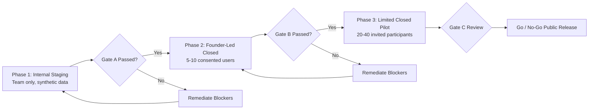

# RC08 — Controlled Pilot Operations

## 1. Staged Pilot Rollout Strategy
The pilot proceeds through 3 sequential, strictly gated phases:

## 2. Participant Onboarding & Support
1. **Consent Protocol**: Participants review and sign itemized digital consent forms.
2. **Support Channel**: Direct in-app feedback link and designated support contact.
3. **Emergency Off-Ramp**: Participants can withdraw consent and delete all data instantaneously at any point.

## 3. Pilot Success & Health Metrics
- **Activation Rate**: Percentage of invited users who complete onboarding.
- **Try-On Satisfaction**: User rating (1–5 scale) on visual realism and fit fidelity.
- **Retailer Handoff Rate**: Click-through percentage to retailer purchase pages.
- **Crash-Free Sessions**: ≥ 99.0% crash-free mobile sessions.
- **Inference Cost / Completed VTO**: Observed compute cost per delivered try-on result.
