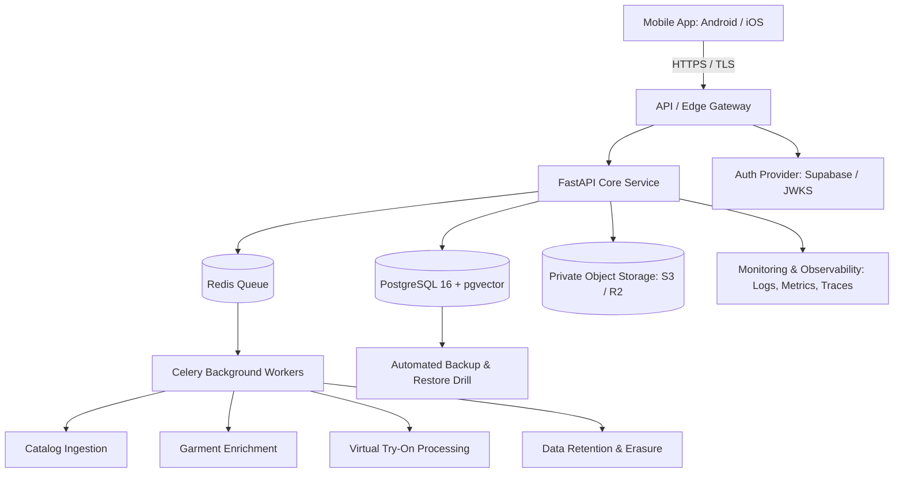

# RC08 — Production Deployment, Security Hardening, Observability & Controlled Pilot Readiness

## Executive Summary
Recovery Cycle 08 (RC08) transitions FashXStudio from a code-complete MVP foundation into a deployable, security-hardened, observable staging and controlled pilot environment. It establishes the infrastructure, configuration invariants, security boundaries, and disaster recovery procedures needed before inviting real users.

Demo-ready is not pilot-ready: real cloud credentials, hosted databases, private object storage, external VTO provider verification, and legal terms must be proven with verified runtime evidence rather than code fixtures.

## Architecture Overview

## Workstream Register
| Workstream | Name | Focus |
|---|---|---|
| RC08-A | Infrastructure | Reproducible staging deployment, container images, networking |
| RC08-B | Identity & Security | Real authentication, secret injection, rate limits, access control |
| RC08-C | Data & Privacy | PostgreSQL, private S3/R2 storage, retention and erasure |
| RC08-D | AI & Integrations | Authorized catalog sources, FashionCLIP embeddings, VTO provider verification |
| RC08-E | Observability | Structured logging, metrics, alerts, SLOs, incident response |
| RC08-F | Pilot Operations | Physical device QA, cohort onboarding, measured release gates |

## Deliverables Index
| Identifier | File | Purpose |
|---|---|---|
| D08.00 | `00_BASELINE_AND_SCOPE.md` | Commit baseline, branch topology, scope boundaries |
| D08.01 | `01_DEPLOYMENT_ARCHITECTURE.md` | Staging 3-tier architecture, network topology |
| D08.02 | `02_ENVIRONMENT_CONFIGURATION.md` | Configuration validation, environment separation |
| D08.03 | `03_AUTHENTICATION_AND_SECURITY.md` | JWKS authentication, RBAC, security headers, rate limits |
| D08.04 | `04_DATABASE_AND_MIGRATIONS.md` | PostgreSQL migrations, pgvector, connection pooling |
| D08.05 | `05_OBJECT_STORAGE_AND_PRIVACY.md` | Private bucket access, signed URLs, cascading erasure |
| D08.06 | `06_CATALOG_AND_AI_PROVIDER_READINESS.md` | Feed permissions, real embedding verification, VTO execution |
| D08.07 | `07_CI_CD_AND_DEPLOYMENT.md` | Immutable image builds, staging pipeline, rollback protocol |
| D08.08 | `08_OBSERVABILITY_AND_SLOS.md` | Structured logs, Prometheus metrics, alerting rules, SLO budgets |
| D08.09 | `09_BACKUP_AND_DISASTER_RECOVERY.md` | Automated backup schedules, point-in-time recovery, RTO/RPO drills |
| D08.10 | `10_MOBILE_RELEASE_AND_DEVICE_QA.md` | Android/iOS physical device test matrix, EAS builds |
| D08.11 | `11_LEGAL_AND_VENDOR_READINESS.md` | DPDP Act review, vendor agreements, rights documentation |
| D08.12 | `12_PILOT_OPERATIONS.md` | Staged cohorts (internal, closed founder-led, limited 20-40) |
| D08.13 | `13_RELEASE_GATES.md` | G1–G6 verification criteria and hard stop rules |
| D08.14 | `14_EXECUTION_GUIDE.md` | Step-by-step commands for local and staging rehearsal |
| D08.15 | `15_TEST_PLAN.md` | Unit, integration, security, mobile, and contract test matrix |
| D08.16 | `16_INCIDENT_RESPONSE.md` | Severity levels, triage runbooks, post-mortem process |
| D08.17 | `17_ACCEPTANCE_REPORT.md` | Gate decisions, evidence register, human sign-off |
| D08.T | `tasks/RC08_TASK_LIST.md` | Granular execution checklist |
