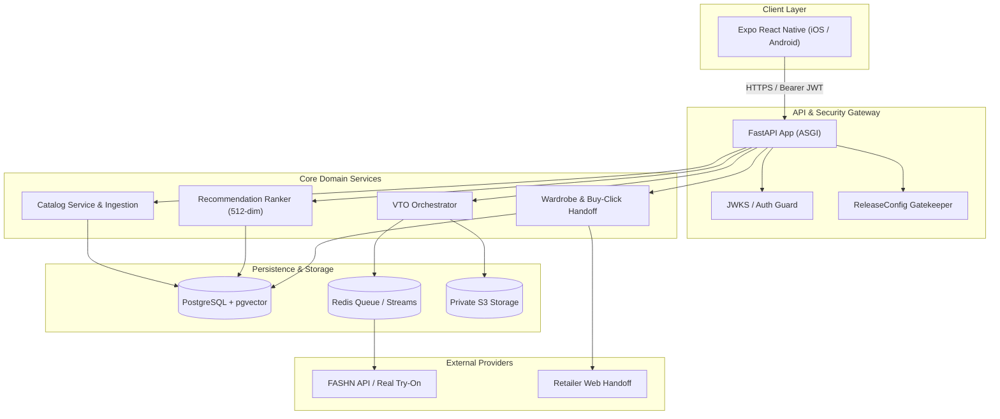

# RC10: Optimization Architecture

## 1. System Context
FashXStudio connects mobile clients with a modular backend API, persistent PostgreSQL storage (with pgvector for visual and semantic embeddings), Redis job queues, and external AI try-on providers.

## 2. Invariants & Guardrails
1. **Zero Fake Data as Pilot Evidence**: Simulated or test datasets must never be marked as real pilot evidence.
2. **Fail-Closed Release Gates**: All 9 beta gates (`B1` through `B9`) must evaluate to True for release authorization (`GO`); any missing or false gate holds release (`HOLD`).
3. **Environment Security**: Production configurations reject mock VTO providers, local SQLite storage, wildcard CORS, and debug modes.
4. **Idempotency & Deduplication**: Purchase clicks, wardrobe additions, and try-on requests enforce strict idempotency keys and prevent duplicate submissions.
