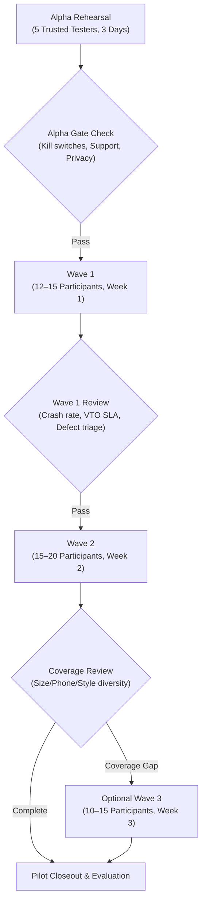

# RC11: Pilot Protocol & Cohort Governance

## 1. Frozen Plan Alignment
RC11 operationalizes the pre-registered protocol defined in [`docs/pilot/pilot-plan.md`](file:///c:/Users/ASUS/Documents/FashXStudio/docs/pilot/pilot-plan.md). The experiment parameters and success thresholds are strictly frozen.

## 2. Cohort Structure & Staging

### Cohort Targets
| Cohort | Size Target | Purpose | Duration |
| :--- | :--- | :--- | :--- |
| **Alpha** | 5 | Rehearse onboarding, deletion, kill switches, and support | 3 days |
| **Wave 1** | 12–15 | Collect first live telemetry, detect UX friction | Week 1 |
| **Wave 2** | 15–20 | Validate bug fixes, broaden demographic mix | Week 2 |
| **Wave 3 (Optional)** | 10–15 | Targeted top-up to fill demographic/size coverage gaps | Week 3 |

### Mandatory Coverage Targets
- **Size Distribution**: At least 3 active participants each in **S**, **M**, **L**, and **XL+**.
- **Platform Parity**: Android majority plus at least **10 iPhone users**.
- **Neutrality**: At least **50% of participants** with no personal tie to the team.
- **Ethnic Wear**: At least **5 regular ethnic-wear shoppers** (kurtas, anarkalis).
- **Geography**: Multiple cities including at least one **tier-2+ / non-metro** location.

## 3. Change Control Window
During Weeks 2 and 3 of the pilot:
- **Strictly Prohibited**: Changing ranker scoring weights, MMR diversity hyperparameters, taste vector logic, or onboarding sequence steps.
- **Permitted**: Critical bug fixes, crash patches, and server stability deployments (each logged in `docs/pilot/change-log.md`).
