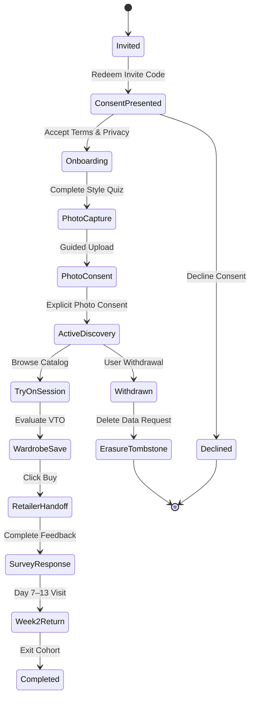

# RC11: Participant Operations & Consent Lifecycle

## 1. Participant Lifecycle
Every participant moves through a governed, voluntary operational sequence:

## 2. Pseudonymous Participant Codes
- Participants are assigned randomized identifiers (e.g. `P-0001` through `P-0070`).
- The mapping between `P-xxxx` codes and real contact information (name, email, phone) is stored in a separate, access-restricted recruitment ledger.
- The application database and analytics streams **only** reference internal pseudonymous UUIDs and cohort tags—never personal contact details.

## 3. Voluntary Consent & Ethical Standards
1. **Uncoerced Consent**: Declining photo consent must never be treated as an error or trigger coercive pop-ups; alternative generic avatar try-on must be offered.
2. **Transparent Purpose**: Participants are explicitly informed what data is captured, how it is processed by vendor APIs, where it is stored, how long it is retained, and how it can be deleted.
3. **No Secondary Training**: Participant photos are strictly prohibited from being used for foundation model training or commercial vendor dataset expansion.
4. **Immediate Withdrawal**: Participants can withdraw at any time directly through the in-app settings; withdrawal triggers immediate data erasure and stops research telemetry.
