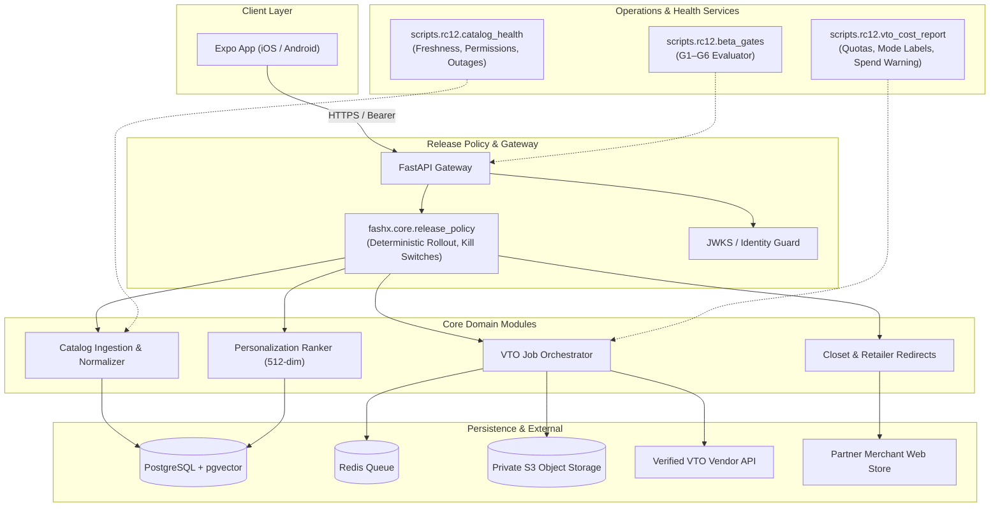

# RC12: Productization Architecture

## 1. System Topology
RC12 preserves the modular monolith architecture while introducing strict server-side capability policy enforcement and operational health monitors.

## 2. Invariants
- **Deterministic Cohorting**: Users are mapped to rollout percentages using `sha256(salt:capability:user_id) % 100`.
- **Fail-Closed Capabilities**: Unconfigured capabilities or capabilities requiring unverified providers fail closed.
- **Retailer Redirection**: Handoffs validate destination domains against an approved partner allowlist.
