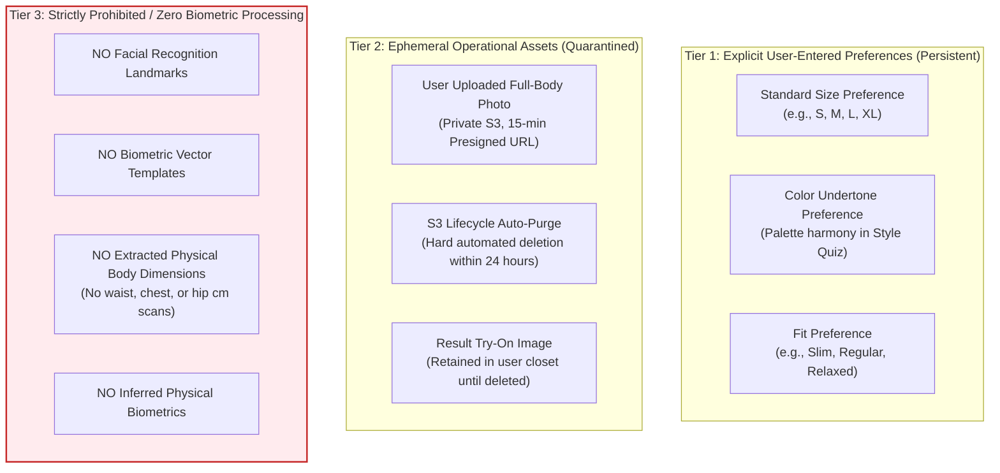

# RC13: Privacy Architecture, Data Taxonomy & Legal Compliance

> [!IMPORTANT]
> **Data Privacy Taxonomy & Clarification**: This document resolves the apparent contradiction between early user profile descriptions (mentioning size, fit, and skin tone preferences) and zero-biometric privacy commitments.

---

## 1. Precise Data Taxonomy & Categorization

To ensure rigorous adherence to the **India Digital Personal Data Protection (DPDP) Act 2023** and prevent regulatory exposure, user data is strictly segregated into three architectural tiers:

### Tier 1: User-Entered Preferences (Self-Declared, Persistent)
- **What it is**: Categorical sizing preferences (`S`, `M`, `L`, `XL`), fit preferences (`Slim`, `Regular`, `Oversized`), and color palette choices selected by the user during the Style Quiz.
- **How it is handled**: Stored as plain database attributes in the user profile table to power catalog filtering and recommendation scoring.
- **What it is NOT**: It is **not** an automated physical scan or biometric extraction from user photos.

### Tier 2: Ephemeral Operational Assets (Quarantined, Auto-Purged)
- **What it is**: The raw photograph captured by the user to generate a requested virtual try-on.
- **Lifecycle & Quarantine**:
  - Uploaded directly via short-lived (15-minute) pre-signed S3 URLs to a private, non-public bucket.
  - S3 bucket lifecycle rules enforce hard automated deletion within 24 hours.
  - Zero access by third-party web scrapers or unauthenticated requests.

### Tier 3: Zero Biometric Identifiers (Strict Prohibition)
- **Commitment**: FashXStudio strictly **does not extract, calculate, or persist** biometric identifiers.
- **Prohibitions**:
  - No facial landmark vectors or facial recognition matching.
  - No 3D body mesh dimensioning or millimeter-level anatomical measurements.
  - No skin tone extraction from photo pixels; color recommendations rely exclusively on self-declared quiz preferences.
- **Verification**: Enforced by [`scripts/rc13/validate_evidence.py`](file:///c:/Users/ASUS/Documents/FashXStudio/scripts/rc13/validate_evidence.py) via automated PII and forbidden-key scanning (`waist_cm`, `chest_cm`, `hip_cm`, `skin_tone`, `raw_photo`).

---

## 2. Right to Erasure & Deletion Verification

Under Section 12 of the DPDP Act 2023, data principals have the unconditional right to data erasure:
1. **Endpoint**: `DELETE /api/v1/auth/delete-account` (implemented in `backend/fashx/core/`).
2. **Cascading Erasure Contract**:
   - `users`, `user_profiles`, `style_preferences` purged.
   - `consent_records` marked erased with cryptographic timestamp.
   - Private S3 objects (uploaded photos, intermediate try-on artifacts) immediately deleted.
   - User-generated try-on ratings and recommendation analytics anonymized (user foreign keys set to null/pseudonymous hash).
3. **Automated Deletion Tests**: Verified in `tests/security/test_rc10_privacy_regression.py`.

---

## 3. Outstanding Legal & Staging Validations
Before authorizing a public beta:
1. **S3 Bucket Lifecycle Audit**: Must execute a real AWS CLI / cloud audit confirming active bucket lifecycle rules on the staging environment.
2. **Independent Legal Sign-Off**: Terms of Service and Privacy Policy require formal review by qualified Indian legal counsel regarding DPDP 2023 compliance.
