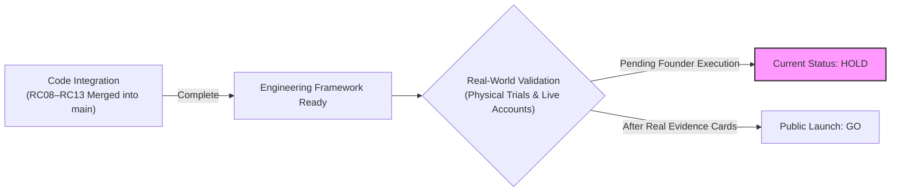

# RC13: Final Market Readiness & Release Decision

## 1. Executive Summary & Governed Decision
- **Final Release Gate Decision**: **HOLD (NOT VALIDATED FOR PUBLIC LAUNCH)**
- **Code & Test Integration State**: **MERGED & VERIFIED ON MAIN (PRs #30, #31, #32, #33 MERGED)**
- **Milestone Scope**: RC13.1 Governance Correction & Audit Remediation

---

## 2. Decision Rationale & Separation of Concerns

The market-readiness audit establishes a clear separation between **code integration** and **real-world evidence**:

1. **Software Integration Is Merged**:
   - PR #30 (RC08 Staging & Security), PR #31 (RC11 Beta Pilot Scaffolding), PR #32 (RC12 Productization), and PR #33 (RC13 Validation Engine) are all merged into `main` (`050b504`).
   - The test suites (35 RC13 tests, 95 cross-cycle regression tests, 165 mobile tests) pass cleanly.
2. **Real-World Evidence Is Outstanding**:
   - In accordance with `AGENTS.md` Rule 1 and Rule 2, no real users, merchant agreements, or paid cloud vendor GPU runs have been recorded yet in `docs/evidence/`.
   - The release gate engine ([`scripts/rc13/evaluate_release_gates.py`](file:///c:/Users/ASUS/Documents/FashXStudio/scripts/rc13/evaluate_release_gates.py)) correctly and securely evaluates the current repository state to `HOLD`.

---

## 3. Post-Merge Operational Action Checklist for the Founder

With code branches merged into `main`, the operational path forward requires executing physical and cloud trials:

| Step | Action Item | Target Artifact / Evidence |
|---|---|---|
| **1** | **Deploy Staging Infrastructure** | Deploy PostgreSQL with `pgvector`, Redis, and private S3 buckets on cloud hosting. Run live migrations (`alembic upgrade head`). |
| **2** | **Verify Commercial VTO Provider** | Connect live GPU vendor API keys (e.g. cloud GPU worker endpoint), execute 20–30 test runs, record P95 latency and defect rates. |
| **3** | **Secure Real Merchant Feeds** | Execute affiliate agreements or licensed partner product feeds for 100+ active catalog garments with live images. |
| **4** | **Conduct Controlled Participant Pilot** | Recruit 40–50 real shoppers per [`docs/pilot/pilot-plan.md`](file:///c:/Users/ASUS/Documents/FashXStudio/docs/pilot/pilot-plan.md); collect M1–M5 must-have telemetry and S1–S4 survey data. |
| **5** | **Author Authentic Evidence Cards** | Human founder writes evidence cards directly to `docs/evidence/` with raw command outputs, real SHA-256 checksums, and reviewer sign-off. |
| **6** | **Run Release Gates CLI** | Execute `python scripts/rc13/evaluate_release_gates.py --verify-on-disk`. Upon 6/6 PASS, issue `GO` decision. |
