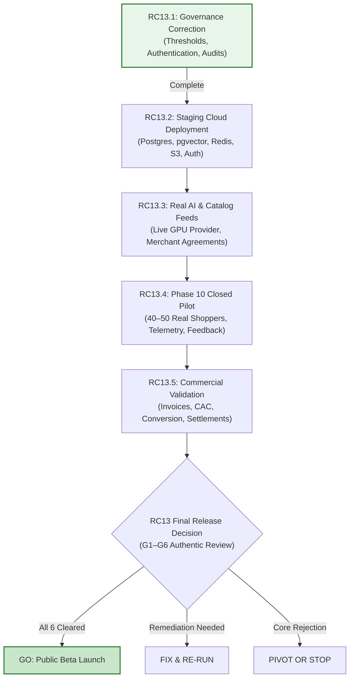

# RC13.1: Market Readiness Audit & Governance Correction Report

**Audit Date**: November 9, 2026  
**Auditor Finding**: Market Readiness: `HOLD — Not Validated for Public Launch`  
**Milestone Focus**: RC13.1 Governance Correction & Audit Remediation  
**Status**: REMEDIATION DELIVERED & VERIFIED  

---

## 1. Executive Summary

A comprehensive repository and market-readiness audit conducted on November 9, 2026 acknowledged the successful code integration of recovery pull requests (PR #30, #31, #32, and #33 merged into `main`), but correctly identified six critical governance, documentation, and threshold defects:
1. Stale post-merge checklists in RC13 documents.
2. Threshold divergence between the RC13 product evaluator and the frozen pilot plan (`docs/pilot/pilot-plan.md`).
3. Threshold misalignment between the VTO evaluator and release gates.
4. Absence of cryptographic source file authentication in the evidence validator.
5. Apparent contradiction between user profile descriptions and zero-biometric claims.
6. Ungrounded unit economics assumptions presented without cost accounting protocols.

Milestone **RC13.1** comprehensively remedies every identified issue, aligning the evaluation codebase with the frozen contract and providing authentic governance for the upcoming staging and pilot trials.

---

## 2. Systematic Remediation Matrix

| # | Audit Finding | Root Cause | Engineering & Governance Remediation in RC13.1 | Verified Output |
|---|---|---|---|---|
| **1** | **Stale Post-Merge Checklist** | RC13 docs retained pre-merge instructions directing the founder to merge branches that were already merged via PRs #30–#33. | Updated [`00_BASELINE_RECONCILIATION.md`](file:///c:/Users/ASUS/Documents/FashXStudio/docs/reengineering/RC13/00_BASELINE_RECONCILIATION.md) and [`13_FINAL_DECISION.md`](file:///c:/Users/ASUS/Documents/FashXStudio/docs/reengineering/RC13/13_FINAL_DECISION.md) to record commit `050b504` on `main`. Separated code completion from physical pilot trials. | Clean documentation checklists |
| **2** | **Pilot Threshold Discrepancy** | `evaluate_product_metrics.py` used a simplified metric subset rather than the authoritative Phase 10 frozen contract. | Refactored [`scripts/rc13/evaluate_product_metrics.py`](file:///c:/Users/ASUS/Documents/FashXStudio/scripts/rc13/evaluate_product_metrics.py) to strictly evaluate the complete contract: 12 Must-Haves (M1–M5), 10 Should-Haves in 4 groups (S1–S4), and 7 hard stop rules. | `PILOT PRODUCT DECISION: GO` on complete fixture; fail-closed on omissions |
| **3** | **VTO Evaluator Misalignment** | Evaluator enforced 30s P95 latency and 95% completion, conflicting with the 45s / 90% gate ceiling in `gates.md` and `pilot-plan.md`. | Reconciled [`scripts/rc13/evaluate_vto.py`](file:///c:/Users/ASUS/Documents/FashXStudio/scripts/rc13/evaluate_vto.py) into a dual-tier standard: Contractual Gate Ceiling (P95 $\le 45\text{s}$, completion $\ge 90\%$, defect $\le 15\%$, rating $\ge 3.8$) and Internal Operational Targets (P95 $\le 30\text{s}$, completion $\ge 95\%$, defect $\le 10\%$, rating $\ge 4.0$). | Evaluates both gate pass and target achievement |
| **4** | **Evidence Authentication Gap** | PII scanner inspected payload keys but did not authenticate source file existence, cryptographic hash, or reviewer legitimacy. | Upgraded [`scripts/rc13/validate_evidence.py`](file:///c:/Users/ASUS/Documents/FashXStudio/scripts/rc13/validate_evidence.py) with `--verify-files`: checks disk existence, SHA-256 byte digest, placeholder reviewer rejection, and future timestamp rejection. | `EVIDENCE VALIDATION & AUTHENTICATION: PASS` |
| **5** | **Privacy Documentation Conflict** | README mentioned body profile measurements while privacy docs claimed zero measurements are extracted. | Updated [`09_PRIVACY_SECURITY_AND_LEGAL.md`](file:///c:/Users/ASUS/Documents/FashXStudio/docs/reengineering/RC13/09_PRIVACY_SECURITY_AND_LEGAL.md) with explicit 3-tier data taxonomy: Tier 1 (Self-declared sizing preferences), Tier 2 (Ephemeral photos auto-deleted in 24h), Tier 3 (Strict prohibition of biometric identifiers, facial landmarks, or body scans). | Clean privacy architecture diagram & clear boundaries |
| **6** | **Ungrounded Unit Economics** | Revenue and try-on costs were presented as verified figures rather than planning models. | Rewrote [`08_UNIT_ECONOMICS.md`](file:///c:/Users/ASUS/Documents/FashXStudio/docs/reengineering/RC13/08_UNIT_ECONOMICS.md) to explicitly label figures as financial hypotheses; documented real-world risks (returns, attribution drop-off, CAC); created the pilot invoice tracking protocol. | Explicit financial governance notice |

---

## 3. Reconciled Metric Contract Comparison

| Domain | Frozen Pilot Plan (`pilot-plan.md`) | Prior RC13 Evaluator | RC13.1 Reconciled Evaluator |
|---|---|---|---|
| **M1: Activation** | $\ge 60\%$ login invitees; $\ge 80\%$ onboarding starters | Login $\ge 70\%$ | **$\ge 60\%$ login invitees; $\ge 80\%$ onboarding starters** |
| **M2: Realism** | Mean $\ge 3.8$; Ratings $\ge 4 \ge 70\%$; Defects $\le 15\%$ | Mean $\ge 3.5$ | **Mean $\ge 3.8$; Ratings $\ge 4 \ge 70\%$; Defects $\le 15\%$** |
| **M3: Reliability** | Crash-free $\ge 99.0\%$; Completion $\ge 90.0\%$; P95 $\le 45\text{s}$ | Crash-free $\ge 99\%$; Completion $\ge 95\%$; P95 $\le 30\text{s}$ | **Crash-free $\ge 99.0\%$; Completion $\ge 90.0\%$ (target $\ge 95\%$); P95 $\le 45\text{s}$ (target $\le 30\text{s}$)** |
| **M4: Trust & Privacy** | $0$ incidents; Comfort survey $\ge 80\%$; Consent drop-off $\le 10\%$ | Incidents $\le 0$ | **$0$ incidents; Comfort survey $\ge 80\%$; Consent drop-off $\le 10\%$** |
| **M5: Retention** | Week-2 return $\ge 50\%$ | Week-2 $\ge 20\%$ | **Week-2 return $\ge 50\%$ (Pivot trigger $< 25\%$)** |
| **Should-Haves** | Groups S1, S2, S3, S4 ($\ge 3$ required) | Not evaluated | **Evaluates S1, S2, S3, S4 groups; $\ge 3$ required for GO** |

---

## 4. Re-Engineered Milestone Roadmap

To transition FashXStudio from code-complete engineering foundation to validated product:

