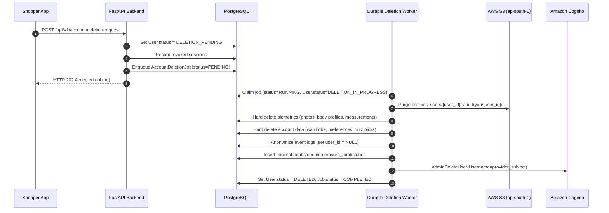

# FashXStudio Account Deletion and Erasure Policy

## 1. Regulatory Framework and Scope
Under the Digital Personal Data Protection Act (DPDP Act, India) and General Data Protection Regulation (GDPR, EU), FashXStudio shoppers have the unconditional right to erase their personal data and terminate their accounts.

## 2. Deletion Stages and State Flow

## 3. Data Classification and Destruction Rules

### 3.1 Biometric and Media Data (Immediate Hard Delete)
- S3 Storage: All private objects under prefixes `users/{user_id}/` and `tryon/{user_id}/`.
- Database Tables:
  - `user_photos`
  - `profile_artifacts`
  - `profile_photo_jobs`
  - `skin_tone_results`
  - `media_objects`
  - `body_profiles`
  - `user_measurements`
  - `user_style_profiles`
  - `tryon_jobs`

### 3.2 Account and Interaction Data (Hard Delete)
- `wardrobe_items`
- `buy_clicks`
- `fit_feedback`
- `tryon_feedback`
- `feed_exclusions`
- `feed_impressions`
- `feed_signals`
- `user_preferences`
- `onboarding_profiles`
- `consent_records`
- `consent_events`
- `style_quiz_picks`
- `idempotency_records`
- `pilot_participants`
- `pilot_survey_responses`
- `pilot_feedback`
- `experiment_exposures`
- `tenant_members`
- `auth_sessions`
- `identity_accounts`
- `auth_identities`

### 3.3 Anonymized Operational Logs (Pseudonymization)
- `domain_events`: `user_id` set to `NULL`. Aggregated telemetry retained without shopper identifiers.
- `pilot_invites`: `user_id` set to `NULL`.

### 3.4 Retained Minimal Tombstone (Resurrection Prevention)
- `erasure_tombstones`: `(user_id, erased_at)`.
- Purpose: Ensures that if an older database snapshot is restored, deleted accounts cannot be resurrected or accessed.

## 4. Failure Modes and Fault Tolerance
- If S3 purging or Cognito communication fails, the job transitions to `RETRY` with exponential backoff (up to 5 attempts).
- The account remains locked in `DELETION_IN_PROGRESS` or `DELETION_PENDING`. No API mutations are allowed.
- Deletion operations are completely idempotent and safe to resume from any step.
