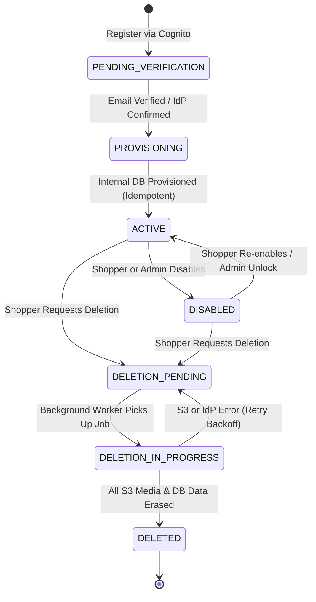

# FashXStudio Account State Machine

## 1. Overview
The FashXStudio account lifecycle state machine governs the state of shopper accounts in the internal PostgreSQL database, decoupled from, but synchronized with, external identity providers such as Amazon Cognito.

## 2. Account States

| State | Description | Allowed Operations | Revocation State |
| :--- | :--- | :--- | :--- |
| `PENDING_VERIFICATION` | Account registered with external IdP, but email verification or initial challenge is pending. | Verify email, resend confirmation code. | Not yet active. |
| `PROVISIONING` | Verified identity confirmed. Database user record and initial profile/consent structures are being idempotently provisioned. | Idempotent provisioning endpoint only. | Session established. |
| `ACTIVE` | Normal operational state. Account is fully verified and provisioned. | Full read/write access (photos, try-on, wardrobe, profile). | Active sessions allowed. |
| `DISABLED` | Account temporarily suspended by shopper or security admin. | None (authenticated API access rejected with 403 Forbidden). | All sessions revoked. |
| `DELETION_PENDING` | Account deletion initiated by shopper. Deletion job enqueued. | None (all authenticated write operations blocked). | All sessions revoked. |
| `DELETION_IN_PROGRESS` | Durable background worker actively purging S3 media, database rows, and Cognito identity. | None. | All sessions revoked. |
| `DELETED` | Terminal state. All personal data, media, and credentials erased. Pseudonymous tombstone retained. | None. Irreversible. | All sessions revoked. |

## 3. State Transitions

## 4. State Transition Rules and Invariants

1. **Terminal State**: `DELETED` is strictly terminal and irreversible. Once transitioned to `DELETED`, no transition back to any state is permitted.
2. **Session Revocation on State Change**:
   - Transitioning to `DISABLED` or `DELETION_PENDING` immediately writes session revocation records to `revoked_auth_sessions` and `auth_sessions`, invalidating all active JWTs.
3. **Idempotent Provisioning**:
   - Multiple concurrent calls to `/api/v1/account/provision` for the same provider subject result in identical internal `user_id` resolution without duplicate user rows or race conditions.
4. **Data Purging Guarantee**:
   - Transition from `DELETION_IN_PROGRESS` to `DELETED` only occurs when S3 objects under `users/{user_id}/` and `tryon/{user_id}/` are purged, database records are erased, and `erasure_tombstones` record is persisted.
